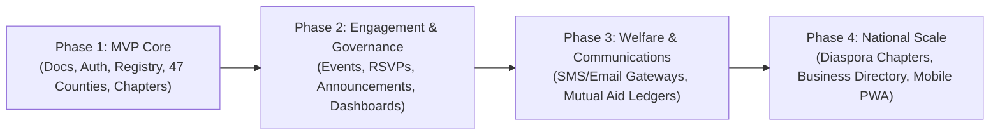

# 00. Vision and Scope: Mulembe National Platform

## 1. Executive Summary
The **Mulembe National Platform** is the official digital infrastructure for the Luhya community across Kenya's 47 counties and global diaspora. Evolving from the localized `mulembe18` pilot, this platform delivers structured community governance, verified membership registries, transparent welfare administration, chapter-based event organization, and socio-economic empowerment.

## 2. Problem Statement
The previous platform encountered structural limitations:
- **Scalability bottlenecks**: Inability to model national geographic hierarchies (County -> Sub-County -> Ward -> Chapter).
- **Security & Authorization**: Unscoped role permissions and scattered business logic in UI components.
- **Data Fragmentation**: Manual, unverified membership lists with inconsistent contact data.
- **Architectural Debt**: High styling coupling and direct database queries without strict service layers.

## 3. Product Vision
To build a resilient, high-performance, and visually prestigious digital hub that connects millions of community members, fosters economic cooperation, preserves cultural heritage, and provides accountable leadership tools.

## 4. Target Personas
1. **Community Member (Diaspora & Domestic)**: Seeks trusted identity verification, cultural connection, chapter activities, and mutual aid/welfare support.
2. **Chapter Executive (Secretary / Chairperson)**: Needs local chapter management tools, meeting scheduling, attendance rosters, and announcement broadcasting.
3. **County Coordinator**: Oversees multi-chapter coordination, dispute resolution, and regional reporting.
4. **National Executive & Elders Council**: Requires platform-wide visibility, auditable decision logging, policy broadcasts, and treasury oversight.

## 5. Goals & Non-Goals

### Goals
- **National Registry**: Verifiable, deduplicated member registry covering all 47 counties of Kenya.
- **Hierarchical Governance**: Granular, scope-aware role-based access control (RBAC).
- **Glassmorphism Aesthetic**: World-class visual standard delivering prestige, trust, and responsive mobile-first performance.
- **Clean Layered Architecture**: Total decoupling of Route Handlers, Controllers, Services, and Repositories.
- **Data Privacy Compliance**: Rigorous alignment with the Kenya Data Protection Act (KDPA 2019).

### Non-Goals
- Political campaigning or non-vetted partisan endorsements.
- Unregulated financial banking (all welfare functions rely on regulated third-party payment gateways with explicit audit logs).
- Unmonitored public chat rooms (communication is structured through moderated announcements, official notices, and verified RSVPs).

## 6. Success Metrics (KPIs)
- **Availability & Performance**: 99.9% uptime on Vercel serverless + TiDB Cloud with sub-second p95 latency.
- **Verification Integrity**: Zero unverified administrative role escalation.
- **Member Engagement**: 80%+ mobile onboarding completion rate.
- **Audit Compliance**: 100% of state-mutating administrative actions logged with actor, timestamp, IP, and payload diff.

## 7. Phased Roadmap

