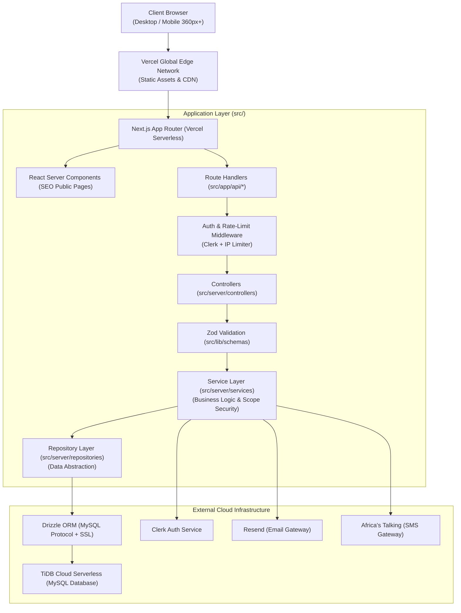

# 03. System Architecture & Request Pipeline

## 1. High-Level Architecture Overview
The Mulembe National Platform is constructed as a modern, decoupled monolithic application running on Next.js App Router, hosted serverlessly on Vercel Edge/Serverless Functions, with a managed distributed MySQL database on TiDB Cloud.

---

## 2. Layering Principles & Folder Responsibilities

1. **`src/app/api/*` (Route Handlers)**:
   - Handle incoming HTTP requests (GET, POST, PUT, DELETE).
   - Extract parameters, headers, and Clerk auth session.
   - Delegate immediately to Controllers.
   - **Zero business logic, zero database queries.**

2. **`src/server/controllers/*` (Controllers)**:
   - Validate request payloads against shared Zod schemas (`src/lib/schemas`).
   - Format HTTP responses and translate service exceptions into standard HTTP error responses (400, 401, 403, 404, 500).

3. **`src/server/services/*` (Service Layer)**:
   - The heart of the platform. Implements all business rules, eligibility criteria, and scope-based authorization checks.
   - Orchestrates multi-repository transactions.
   - Triggers audit logging and notification events.

4. **`src/server/repositories/*` (Repository Layer)**:
   - Abstracts all database queries using Drizzle ORM.
   - Handles pagination, sorting, soft-deletion filters, and relational joins.
   - Completely hides database dialect specifics from the application layer.

5. **`src/lib/*` (Shared Utilities & Cross-Cutting Concerns)**:
   - `schemas/`: Zod schemas shared between client forms and backend validation.
   - `db/`: Drizzle database client instance, connection pool, and configuration.
   - `auth/`: Clerk auth helpers and session extractors.
   - `errors/`: Domain error classes (`NotFoundError`, `ForbiddenError`, `ValidationError`).

---

## 3. Technology Rationale & Architecture Decision Summary

| Component | Selected Technology | Alternative Considered | Rationale |
|---|---|---|---|
| **Framework** | Next.js 15+ (App Router) | Vite SPA, Remix | Seamless RSC for SEO, unified serverless API routes, optimized Vercel deployment. |
| **Styling** | Bootstrap 5 + Sass + React-Bootstrap | Tailwind CSS | Strict document mandate. Robust pre-built accessible components with custom Sass glassmorphism variables. |
| **Database** | TiDB Cloud Serverless (MySQL) | PostgreSQL, Supabase | High-concurrency MySQL-compatible serverless tier, zero infrastructure overhead, automated backups. |
| **ORM** | Drizzle ORM | Prisma | Ultra-lightweight footprint (critical for cold starts), zero binary engine overhead, explicit type-safe SQL queries. |
| **Auth** | Clerk | NextAuth / Auth.js | Enterprise-grade identity, native phone number/SMS auth, session management, and custom metadata sync. |
| **Validation** | Zod | Yup, Joi | TypeScript-first schema generation, type inference shared seamlessly across client and server. |
