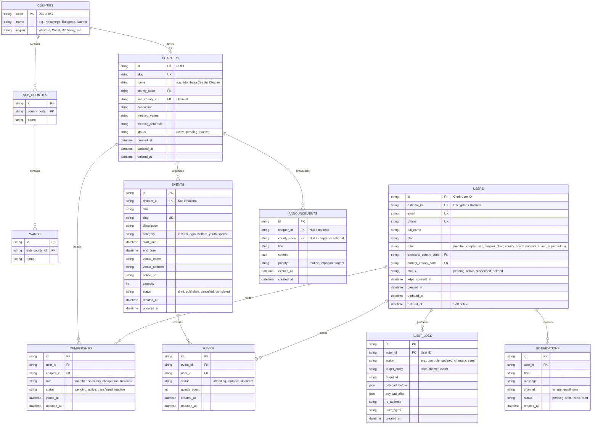

# 04. Database Design & Entity-Relationship Model

## 1. Relational ER Diagram

---

## 2. Indexing Strategy for TiDB Cloud Scale

To support tens of thousands of members across Kenya with sub-50ms query latency:

1. **`users` Table**:
   - `INDEX idx_users_phone (phone)`
   - `INDEX idx_users_email (email)`
   - `INDEX idx_users_role (role)`
   - `INDEX idx_users_current_county (current_county_code)`
   - `INDEX idx_users_clan (clan)`
2. **`memberships` Table**:
   - `UNIQUE INDEX unq_user_chapter (user_id, chapter_id)`
   - `INDEX idx_memberships_chapter_status (chapter_id, status)`
3. **`events` Table**:
   - `INDEX idx_events_chapter_start (chapter_id, start_time)`
   - `INDEX idx_events_status_start (status, start_time)`
4. **`announcements` Table**:
   - `INDEX idx_announcements_scope (chapter_id, county_code, expires_at)`
5. **`audit_logs` Table**:
   - `INDEX idx_audit_actor (actor_id, created_at)`
   - `INDEX idx_audit_target (target_entity, target_id)`
