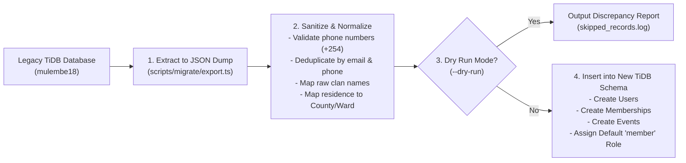

# 10. Data Migration Plan from Legacy mulembe18

## 1. Legacy Data Audit
The legacy `mulembe18` codebase stored records in a MySQL schema with legacy flat structures:
- `members` table: `id`, `name`, `email`, `phone`, `clan`, `residence`, `role`, `status`, `created_at`
- `events` table: `id`, `title`, `date`, `venue`, `description`, `chapter`
- `contributions` / `welfare`: `id`, `member_id`, `amount`, `date`, `receipt_code`

---

## 2. Extraction, Transformation & Loading (ETL) Pipeline

The migration will be executed via standalone Node.js TypeScript scripts in `scripts/migrate/`:

---

## 3. Idempotency & Safety Guarantees
1. **Deduplication**: Records sharing the same phone or email are merged, preserving the latest profile timestamp.
2. **Deterministic Foreign Keys**: Chapter slugs from legacy are mapped to corresponding UUIDs in the new `chapters` table.
3. **Multi-Run Safety**: The migration script checks for record existence before inserting, allowing repeated executions without duplicate record creation.
4. **Verification Run**: At completion, a reconciliation query verifies total row counts between old and new tables.
