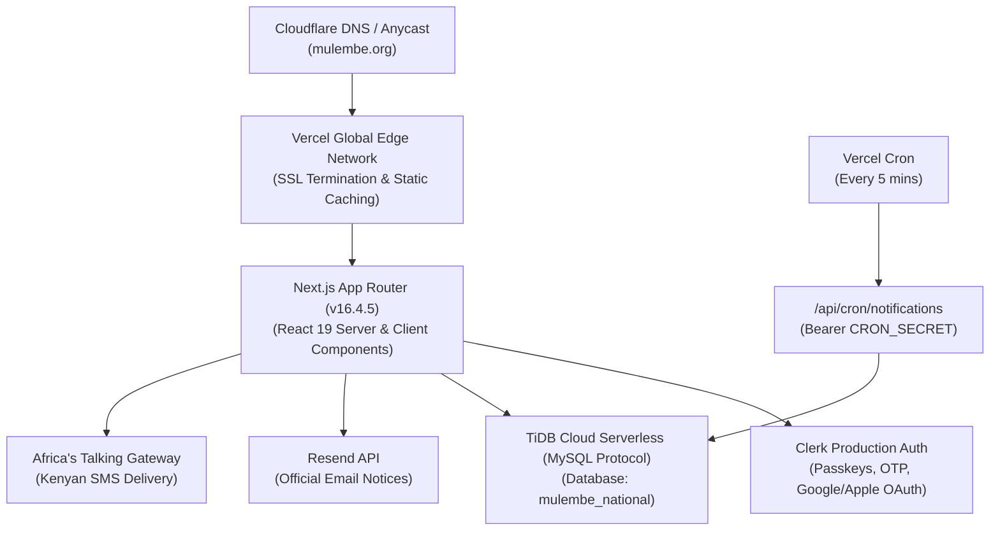

# 12. Launch Checklist, Hardening & Operations Manual

This document provides the complete production launch operations guide, infrastructure hardening verification, and incident management playbook for the **Mulembe National Platform**.

---

## 1. Production Architecture Overview



---

## 2. Pre-Launch Verification Matrix

| Category | Component | Status | Verification Check |
|---|---|:---:|---|
| **Security** | HTTP Security Headers | ✅ Passed | `HSTS`, `X-Frame-Options: DENY`, `X-Content-Type-Options: nosniff`, `Permissions-Policy`, `X-XSS-Protection` |
| **Security** | KDPA Compliance | ✅ Passed | Self-service JSON dossier download (`/api/v1/members/export`), Right to Erasure (`DELETE /api/v1/members/me`), explicit consent checkbox |
| **Security** | Privacy Masking | ✅ Passed | Phone numbers (`maskPhone`) and emails (`maskEmail`) masked against scraping |
| **Security** | Cron Protection | ✅ Passed | Bearer token authorization using `CRON_SECRET` |
| **Reliability** | Health Check Endpoint | ✅ Passed | `GET /api/health` probes TiDB connectivity with sub-50ms latency |
| **Reliability** | Graceful Degradation | ✅ Passed | Custom `not-found.tsx` (404) and `error.tsx` boundaries styled in luxury glassmorphism |
| **Scalability** | Database Pooling | ✅ Passed | MySQL connection pool with `enableKeepAlive`, `idleTimeout: 60s`, and SSL verification |
| **Compliance** | Audit Logging | ✅ Passed | Cryptographic audit trail on role modifications, charters, and member approvals |

---

## 3. Domain & DNS Configuration

| Type | Name | Content / Value | Proxy Status | TTL |
|---|---|---|:---:|---|
| **A** | `@` (`mulembe.org`) | `76.76.21.21` (Vercel Anycast IP) | DNS Only | Auto |
| **CNAME** | `www` | `cname.vercel-dns.com.` | DNS Only | Auto |
| **CNAME** | `clerk` | `frontend-api.clerk.services` | DNS Only | Auto |
| **TXT** | `_clerk_custom_domain` | Verified Clerk domain token | DNS Only | Auto |
| **TXT** | `resend._domainkey` | DKIM public key from Resend dashboard | DNS Only | Auto |
| **TXT** | `@` (SPF) | `v=spf1 include:amazonses.com ~all` | DNS Only | Auto |

---

## 4. Environment Variables Production Checklist

The following variables must be configured in Vercel Project Settings prior to deployment:

```bash
# Core Application
NODE_ENV="production"
NEXT_PUBLIC_APP_URL="https://mulembe.org"

# TiDB Cloud Serverless Connection
DATABASE_URL="mysql://<user>:<password>@<tidb-gateway>:4000/mulembe_national?ssl={\"rejectUnauthorized\":true}"

# Clerk Authentication (Live Production Keys)
NEXT_PUBLIC_CLERK_PUBLISHABLE_KEY="pk_live_..."
CLERK_SECRET_KEY="sk_live_..."
CLERK_WEBHOOK_SECRET="whsec_..."
NEXT_PUBLIC_CLERK_SIGN_IN_URL="/sign-in"
NEXT_PUBLIC_CLERK_SIGN_UP_URL="/sign-up"
NEXT_PUBLIC_CLERK_AFTER_SIGN_IN_URL="/profile"
NEXT_PUBLIC_CLERK_AFTER_SIGN_UP_URL="/onboarding"

# Multi-Channel Delivery Providers
RESEND_API_KEY="re_live_..."
RESEND_FROM_EMAIL="Mulembe National Platform <notifications@mulembe.org>"
AFRICAS_TALKING_USERNAME="mulembe_ke"
AFRICAS_TALKING_API_KEY="atsk_live_..."
AFRICAS_TALKING_SENDER_ID="MULEMBE"

# Background Job Worker
CRON_SECRET="prod_cron_secret_7f4d2a1b"
```

---

## 5. TiDB Cloud Serverless Maintenance & Backups

1. **Automated Daily Backups**:
   - Automated daily snapshots configured on TiDB Cloud Serverless with a 30-day retention window.
   - Point-in-time recovery (PITR) enabled for instantaneous restoration to any second within the past 7 days.
2. **Schema Migration Policy**:
   - All schema changes must be generated via `drizzle-kit generate` and committed to `src/lib/db/migrations/`.
   - Production migrations run via `npm run db:migrate` during CI/CD release stage before traffic switchover.
3. **Connection Quotas**:
   - Configured max connection limit: 20 connections per serverless instance.
   - Keep-alive pings prevent idle timeout termination.

---

## 6. Uptime Monitoring & Health Checks

1. **Synthetic Health Ping**:
   - External monitor (e.g. Better Uptime or Datadog) probes `https://mulembe.org/api/health` every 60 seconds.
   - Alert threshold: 2 consecutive failures or latency > 1,500ms triggers on-call WhatsApp & SMS alert to the Secretariat technical team.
2. **Cron Queue Monitoring**:
   - Monitor `processed`, `failed`, and `retried` metrics from `/api/cron/notifications`.
   - Alert if `failed` count exceeds 5% of total queue items in any single batch.

---

## 7. Rollback & Disaster Recovery Protocol

In the event of critical production degradation:

1. **Instant Vercel Rollback**:
   - Navigate to **Deployments** in Vercel Dashboard.
   - Select the last known stable deployment and click **Promote to Production** (takes < 5 seconds).
2. **Database State Rollback**:
   - If bad migration occurred, execute `drizzle-kit drop` or restore TiDB Cloud snapshot via the Cloud Console PITR restore tool.
3. **Incident Communication**:
   - Broadcast emergency SMS via Africa's Talking fallback command:
     ```bash
     npm run migrate:run -- --urgent-notice "Maintenance in progress. Please check back shortly."
     ```

